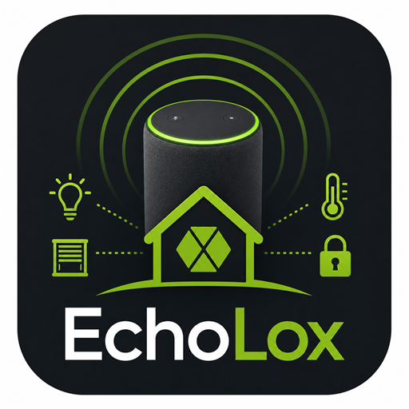

<div align="center">
  
  <h1>EchoLox</h1>
  <p><strong>Alexa mit Loxone verbinden – als Plugin für LoxBerry</strong></p>
</div>

[](https://github.com/BattloXX/EchoLox/releases/latest)
[](go.mod)
[](plugin.cfg)
[](https://github.com/BattloXX/EchoLox/releases)

EchoLox stellt Loxone-Ziele als Lampen einer emulierten Philips Hue Bridge bereit. Alexa sendet einen Befehl an EchoLox; EchoLox übersetzt ihn in einen HTTP- oder UDP-Befehl an den Miniserver. Die eigentliche Licht-, Szenen- und Automationslogik bleibt in Loxone.

**Aktueller stabiler Release: 0.4.0.** Er enthält frei bearbeitbare Zielnamen, die direkte Prüfung virtueller Eingänge, eine integrierte Einrichtungshilfe sowie Korrekturen für Anmeldung, Installation und Dienststart.

- [Installations-ZIP für 0.4.0](https://github.com/BattloXX/EchoLox/releases/download/v0.4.0/EchoLox-0.4.0.zip)
- [Release-Notes für 0.4.0](docs/releases/0.4.0.md)
- [Vollständiges Changelog einschließlich Prereleases](CHANGELOG.md)

## Inhalt

- [Funktionsweise und Funktionsumfang](#funktionsweise-und-funktionsumfang)
- [Voraussetzungen](#voraussetzungen)
- [Installation und Netzwerk](#installation-und-netzwerk)
- [Schnellstart: Küchenlicht](#schnellstart-küchenlicht)
- [Geräte, Schaltmodi und Zielnamen](#geräte-schaltmodi-und-zielnamen)
- [Discovery und Eingangsprüfung](#discovery-und-eingangsprüfung)
- [Alexa verbinden](#alexa-verbinden)
- [HTTP, UDP und MQTT](#http-udp-und-mqtt)
- [Status und Tests verstehen](#status-und-tests-verstehen)
- [Einstellungen und Dateien](#einstellungen-und-dateien)
- [Backup und Wiederherstellung](#backup-und-wiederherstellung)
- [Migration von ha-bridge](#migration-von-ha-bridge)
- [Logs und Fehlerbehebung](#logs-und-fehlerbehebung)
- [Updates und Releasekanäle](#updates-und-releasekanäle)
- [Entwicklung und Builds](#entwicklung-und-builds)
- [API-Referenz](#api-referenz)
- [Grenzen und Sicherheit](#grenzen-und-sicherheit)
- [Lizenz und Marken](#lizenz-und-marken)

## Funktionsweise und Funktionsumfang

```text
Alexa / Echo
    │ SSDP-Suche über IPv4-Multicast, UDP 1900
    │ Hue-kompatible HTTP-API, üblicherweise TCP 80
    ▼
EchoLox auf dem LoxBerry
    │ HTTP-Webservice mit Miniserver-Zugangsdaten
    │ oder UDP-Telegramm an einen eingerichteten UDP-Eingang
    ▼
Loxone Miniserver → dein Loxone-Programm → angeschlossene Geräte
```

EchoLox bietet:

- Schalter, Dimmer, Farblicht und auslösbare Szenen als Hue-Geräte.
- Einen gemeinsamen Ein/Aus-Eingang oder getrennte Impulse für Ein und Aus.
- Bearbeitbare Zielnamen, unabhängig vom Gerätenamen für Alexa.
- Discovery aus den Miniserver-App-Daten und direkte Prüfung bekannter Eingangsnamen.
- Gerätestests, Statusanzeige, Logs, Backup und Import aus ha-bridge.
- Eine eingebettete Weboberfläche mit lokalen Schriften und Bildern.
- Statisch gelinkte Linux-Binaries für amd64, arm64 und armv7; keine Java-Laufzeit erforderlich.

EchoLox legt **keine virtuellen Eingänge im Miniserver** an. Diese müssen bereits im Loxone-Programm existieren und mit der gewünschten Logik verbunden sein.

## Voraussetzungen

| Bestandteil | Voraussetzung |
|---|---|
| LoxBerry | Plugin-Mindestversion laut Metadaten: 2.0; Integration für LoxBerry-4-Logs vorhanden |
| Betriebssystem | Linux auf `x86_64`, `aarch64` oder `armv7l` |
| Miniserver | In LoxBerry hinterlegt, im Netzwerk erreichbar, mit passenden Benutzerberechtigungen |
| Alexa | Ein Echo-Gerät, das die lokale Hue-Bridge-Emulation erkennt |
| Netzwerk | IPv4-Multicast zwischen Echo und LoxBerry sowie HTTP-Zugriff auf die Bridge und den Miniserver |

Für die erste Einrichtung Echo und LoxBerry im selben lokalen Netz betreiben. Gastnetz-Isolation oder blockiertes Multicast können die Suche verhindern. Die Erkennung hängt auch vom verwendeten Echo-Gerät und dessen Software ab; eine Zusage für jedes Modell gibt es nicht.

## Installation und Netzwerk

### 1. HTTP-Port festlegen

Im direkten Betrieb lauscht EchoLox auf **TCP-Port 80**. Wenn LoxBerrys Webserver diesen Port belegt, stelle dessen Weboberfläche vor der Installation auf einen anderen Port um, beispielsweise `88`. Nutze dafür die Webserver-Einstellungen deiner LoxBerry-Version.

Anschließend ist die LoxBerry-Oberfläche beispielsweise unter `http://<loxberry-ip>:88` erreichbar; EchoLox unter `http://<loxberry-ip>/echoloxui/`.

Die alternative gemeinsame Nutzung von Port 80 ist im Abschnitt [Reverse-Proxy](#optional-reverse-proxy) beschrieben.

### 2. Plugin installieren

1. LoxBerry öffnen und zum **Plugin Manager** wechseln.
2. Das [Installations-ZIP](https://github.com/BattloXX/EchoLox/releases/download/v0.4.0/EchoLox-0.4.0.zip) hochladen oder dessen Download-URL für die Installation verwenden.
3. Installation abschließen und **EchoLox** in der Pluginübersicht öffnen.

`postroot.sh` wählt das passende Binary, richtet den Dienst `echolox.service` ein und setzt im direkten Betrieb die Berechtigung zum Binden niedriger Ports. Konfiguration und Gerätedaten liegen im Datenverzeichnis des Plugins.

Nach der Installation kann im direkten Betrieb diese Adresse geprüft werden:

```text
http://<loxberry-ip>/description.xml
```

Die Antwort enthält die Beschreibung der emulierten Hue Bridge, unter anderem `Philips hue bridge 2015`.

### 3. SSDP-Zugriff prüfen

Die Alexa-Suche verwendet **UDP-Port 1900** und die Multicast-Adresse `239.255.255.250`. Der Linux-Listener nutzt Socket-Reuse; exklusiver Portbesitz ist keine grundsätzliche Voraussetzung. Ein anderer Dienst kann die Bindung trotzdem verhindern, wenn dessen Socket-Konfiguration keine gemeinsame Nutzung zulässt.

Meldet das EchoLox-Log einen SSDP-Bindefehler, prüfe den belegenden Dienst. Falls LoxBerrys SSDP-Veröffentlichung den Konflikt verursacht, kann sie in den LoxBerry-Diensteinstellungen deaktiviert werden. Deaktiviere Dienste gezielt anhand des tatsächlichen Fehlers.

### Optional: Reverse-Proxy

Apache kann auf Port 80 bleiben und die Hue-Endpunkte an EchoLox auf Port `8098` weiterleiten. Nach der Plugininstallation lässt sich dieser Modus über den mitgelieferten Helfer einrichten:

```bash
sudo /opt/loxberry/bin/plugins/EchoLox/reverse-proxy-setup.sh --setup
sudo systemctl restart echolox.service
```

Der Helfer setzt `server.port: 8098` und `server.discovery_port: 80`. Er leitet die Hue-Pfade `/description.xml`, `/api` und die Hue-Logos weiter; die gesamte EchoLox-Oberfläche wird dadurch nicht auf Apache-Port 80 veröffentlicht. Öffne das Plugin über LoxBerry oder die interne EchoLox-Adresse.

Der Modus bearbeitet die zentrale Apache-Konfiguration und ist optional. Entfernt ein LoxBerry-Update den Proxyblock, zeigt **Einstellungen → Port 80 / Reverse-Proxy** den Zustand und bietet **Reverse-Proxy wiederherstellen** an. Nach Updates auch die Werte `server.port` und `server.discovery_port` prüfen: Das Installationsskript `postinstall.sh` entfernt vorhandene `discovery_port`-Zeilen bei seiner Konfigurationsmigration.

## Schnellstart: Küchenlicht

Dieses Beispiel verwendet einen einzigen Eingang mit dauerhaftem Zustand: **1 = ein, 0 = aus**.

### 1. Miniserver auswählen

Unter **EchoLox → Einstellungen**:

1. Den in LoxBerry hinterlegten Miniserver auswählen.
2. **HTTP** als gemeinsame Übertragungsart wählen.
3. **Speichern** und **Dienst neu starten** anklicken.
4. **Gespeicherte Verbindung prüfen** ausführen.

Diese Prüfung liest die App-Daten des Miniservers. Sie bestätigt weder die Existenz deines speziellen Eingangs noch die Funktion der angeschlossenen Lichtlogik.

Fehlt der Miniserver in der Liste, hinterlege ihn mit Adresse und Zugangsdaten zuerst in der Miniserver-Verwaltung von LoxBerry.

### 2. Virtuellen Eingang in Loxone vorbereiten

1. In Loxone Config unter den virtuellen Eingängen einen normalen **Virtuellen Eingang** anlegen.
2. Als Bezeichnung exakt `echolox_licht_kueche` verwenden.
3. Mit einer Logik verbinden, bei der der Wert `1` einschaltet und `0` ausschaltet.
4. Das Programm auf den Miniserver übertragen.

Ein **Virtueller HTTP Eingang** fragt externe Webseiten ab. Für die hier verwendeten HTTP-Webservice-Befehle wird ein normaler virtueller Eingang benötigt; an diesem werden keine HTTP-Methode und keine URL konfiguriert.

Wenn dein Loxone-Baustein getrennte Impulse für Ein und Aus erwartet, verwende stattdessen den [Schaltmodus Impuls](#schaltmodi).

### 3. Namen prüfen

**Discovery → Virtuellen Eingang prüfen** öffnen und `echolox_licht_kueche` eingeben. Diese Prüfung liest den Status und schaltet nicht.

Der Eingang muss nicht in der automatischen Scanliste erscheinen. Bei erfolgreicher Prüfung kannst du mit **Als Gerät anlegen** fortfahren.

### 4. Gerät zuordnen

Alternativ direkt **Geräte → Gerät anlegen** öffnen:

| Feld | Wert |
|---|---|
| Name für Alexa | `Küchenlicht` |
| Was soll Alexa steuern? | `Schalter – Ein und Aus` |
| Schaltmodus | `Ein/Aus` |
| Ziel **Ein und Aus** | `echolox_licht_kueche` |

**Speichern** anklicken. Der Alexa-Name und der Miniserver-Eingangsname dürfen verschieden sein.

### 5. Schalten und anschließend Alexa prüfen

**Schaltbefehl testen** sendet Testwerte an die gespeicherten Ziele. Das kann die Beleuchtung einschalten. Meldet der Test Erfolg, hat der Miniserver die Werte angenommen; prüfe zusätzlich, ob die gewünschte Funktion tatsächlich reagiert.

Wenn das funktioniert, Alexa nach neuen Geräten suchen lassen. Ein passender Sprachbefehl für das Beispiel lautet: **„Alexa, schalte Küchenlicht ein.“**

Weitere Hilfe findest du direkt im Plugin unter **Hilfe** (`/echoloxui/help.html`).

## Geräte, Schaltmodi und Zielnamen

### Gerätetypen

| Typ in der Oberfläche | Funktion | Werte an Loxone |
|---|---|---|
| Schalter | Ein und Aus | `1`/`0` oder getrennte Impulse |
| Dimmer | Zusätzlich Helligkeit | `0` bis `100` |
| Farblicht | Zusätzlich Farbton und Farbsättigung | Farbton `0` bis `360`, Sättigung `0` bis `100` |
| Szene | Ein Aktivierungsziel auslösen | `1` |

Die zugeordneten Eingänge müssen diese Werte in deiner Loxone-Logik sinnvoll verarbeiten. Ein einzelner virtueller Eingang übernimmt nicht automatisch die Funktion eines vollständigen Lichtcontrollers.

### Schaltmodi

| Modus | Benötigte Schaltziele | Einschalten | Ausschalten |
|---|---|---|---|
| **Ein/Aus** | Ein gemeinsames Ziel | Ziel erhält `1` | Dasselbe Ziel erhält `0` |
| **Impuls** | Getrenntes Ein- und Aus-Ziel | Impuls an das Ein-Ziel | Impuls an das Aus-Ziel |

Bei HTTP wird ein Impuls als `/pulse` gesendet. Beim UDP-Transport bleibt der Telegrammwert `Impuls`; dafür muss ein passender UDP-Befehl eingerichtet sein.

### Automatische Vorschläge und eigene Namen

EchoLox schlägt Namen mit `echolox_` vor. Leerzeichen und Sonderzeichen werden zu Unterstrichen; Umlaute werden unter anderem in `ae`, `oe`, `ue` und `ss` umgewandelt.

Beispiel für **Wohnzimmer Licht**:

| Verwendung | Ein/Aus | Impuls |
|---|---|---|
| Einschalten / gemeinsames Schaltziel | `echolox_wohnzimmer_licht` | `echolox_wohnzimmer_licht_on` |
| Ausschalten | Dasselbe Ziel | `echolox_wohnzimmer_licht_off` |
| Helligkeit bei Dimmer/Farblicht | `echolox_wohnzimmer_licht_brightness` | Gleich |
| Farbton bei Farblicht | `echolox_wohnzimmer_licht_hue` | Gleich |
| Farbsättigung bei Farblicht | `echolox_wohnzimmer_licht_saturation` | Gleich |

Für eine Szene wird beispielsweise `echolox_abendstimmung_activate` vorgeschlagen.

Alle Zielnamen sind bearbeitbar. Vorhandene Namen brauchen kein `echolox_`-Präfix. Gespeicherte Zuordnungen bleiben beim Bearbeiten und Umbenennen erhalten; vergleiche sie nach einer Änderung von Typ oder Schaltmodus mit deiner Loxone-Logik.

Die **Übertragungsart gilt gemeinsam für alle Geräte** und wird unter Einstellungen festgelegt. Das Geräteformular zeigt diesen Einstellungswert an. Eine unabhängige Auswahl je Gerät ist derzeit nicht implementiert.

## Discovery und Eingangsprüfung

Unter **Discovery** gibt es zwei unterschiedliche Wege:

| Funktion | Datenquelle | Wirkung |
|---|---|---|
| **Miniserver scannen** | `/data/LoxAPP3.json` | Schlägt Geräte aus App-Bedienelementen und vorhandenen VI-Einträgen vor |
| **Virtuellen Eingang prüfen** | `/jdev/sps/io/<name>/state` | Prüft einen bekannten Namen direkt, ohne zu schalten |

Der Scan berücksichtigt virtuelle Eingänge und geeignete Bedienelemente wie Schalter, Dimmer und Lichtcontroller. Er ist keine vollständige Auflistung aller Eingänge deines Loxone-Programms. Deshalb können Schalter sichtbar sein, während ein angelegter virtueller Eingang fehlt.

- Fehlenden Eingang gezielt über seinen exakten Namen prüfen oder manuell im Geräteformular zuordnen.
- Bei Scanvorschlägen Namen, Typ und Schaltmodus vor dem Import kontrollieren.
- Bereits zugeordnete Ziele werden in der Scanliste als importiert markiert.
- Direkte Bedienelemente werden über ihren Namen angesprochen; ihre tatsächliche Reaktion mit der angeschlossenen Logik prüfen.

Eine erfolgreiche Namensprüfung bestätigt einen lesbaren Endpunkt. Sie überprüft nicht die Verkabelung oder Funktionsweise deines Loxone-Programms.

## Alexa verbinden

EchoLox emuliert das Hue-Modell `BSB002` mit API-Version `1.47.0`. Der Ablauf ist:

1. Echo sendet eine SSDP-Suchanfrage im lokalen IPv4-Netz.
2. EchoLox antwortet mit der Adresse seiner `description.xml`.
3. Alexa liest die Hue-API und die gespeicherten Geräte.

EchoLox kündigt sich beim Start und danach alle **fünf Minuten** per SSDP an. Unter **Discovery → Echo / Alexa Geräte** stehen die Geräte, deren Suchanfragen EchoLox empfangen hat. Das bestätigt den Netzwerkkontakt, aber noch keine erfolgreiche Einrichtung in Alexa.

**Bridge für Alexa erneut bekannt machen** sendet eine neue Netzwerkanmeldung und signalisiert vorübergehend eine frische Bridge. Der Button löscht keine Alexa-Geräte und ist kein vollständiger Alexa-Reset.

Beispiele für Sprachbefehle sind „schalte Küchenlicht ein“, „schalte Küchenlicht aus“ oder bei einem Dimmer „dimme Wohnzimmer Licht auf 50 Prozent“. Verwende den gespeicherten Gerätenamen beziehungsweise die Zuordnung in Alexa. EchoLox stellt auch Szenenziele über die Hue-Lampen-Emulation bereit; die nutzbare Sprachform hängt von der Alexa-Zuordnung ab.

Geräte-IDs werden gespeichert. Die Bridge-Identität wird ohne explizite UUID aus der IPv4-Adresse und gegebenenfalls einem vorhandenen Salt abgeleitet. Eine feste Adresse hilft, diese Identität beizubehalten. Unter den erweiterten Einstellungen kann eine feste Identität mit zwölf Hex-Zeichen gesetzt werden; Änderungen können eine erneute Gerätesuche erfordern.

## HTTP, UDP und MQTT

### HTTP

HTTP ist die Voreinstellung. EchoLox liest Miniserver-Adresse, Port, Benutzername und Passwort aus LoxBerrys `general.json`. Raw-Zugangsdaten werden bevorzugt; andernfalls werden URI-kodierte Werte einmal dekodiert.

Für das Küchenlicht werden diese Pfade aufgerufen:

```text
Ein:   /dev/sps/io/echolox_licht_kueche/1
Aus:   /dev/sps/io/echolox_licht_kueche/0
```

Die Anmeldung erfolgt mit HTTP Basic Auth. EchoLox prüft den Loxone-Ergebniscode in XML- oder JSON-Antworten; HTTP 200 allein gilt nicht als Bestätigung. HTTPS zum Miniserver und eine WebSocket-Verbindung sind in diesem Client nicht implementiert.

### UDP

Für UDP muss in Loxone ein virtueller UDP-Eingang mit passenden Befehlen und Erkennungsregeln eingerichtet sein. Unter Einstellungen wird dessen Port angegeben, standardmäßig `7777`.

EchoLox sendet UTF-8-Text in diesem Format; `\r\n` steht für den tatsächlichen Zeilenabschluss:

```text
echolox_licht_kueche=1\r\n
```

Ein erfolgreiches lokales Senden bestätigt keine Verarbeitung durch den Miniserver. Die Namensprüfung und der Miniserver-Scan verwenden auch bei ausgewähltem UDP weiterhin HTTP und prüfen nicht die UDP-Erkennungsregel.

### MQTT: vorbereitete Konfiguration

In 0.4.0 sind Brokerfelder und eine Verwaltung von Topic-Ziel-Zuordnungen vorhanden. Die Zuordnungen werden in `mqtt_subscriptions.json` gespeichert. Der laufende Dienst bindet derzeit jedoch **keinen MQTT-Client zum Empfangen und Weiterleiten** dieser Nachrichten an.

Auch MQTT-Publishing als Gerätetransport ist nicht implementiert. Verwende für die tatsächliche Steuerung HTTP oder UDP. Ein alter Konfigurationswert `transport: "mqtt"` führt zu einem Fehler und wird nicht stillschweigend auf HTTP umgestellt.

## Status und Tests verstehen

| Prüfung | Schaltet? | Was sie aussagt |
|---|---|---|
| Gespeicherte Verbindung prüfen | Nein | Die App-Daten des ausgewählten Miniservers sind lesbar |
| Virtuellen Eingang prüfen | Nein | Der bekannte Zielname ist direkt lesbar |
| Status aktualisieren | Nein | App-Daten und angezeigte Eingangsprüfungen werden aktualisiert |
| Schaltbefehl testen | Ja | Testwerte werden an alle gespeicherten Ziele des Geräts gesendet |

Der Gerätetest sendet für Helligkeit `50`, für Ein-/Aus-Impulse `pulse` über HTTP und für die übrigen Ziele grundsätzlich `1`. Er kann daher Licht einschalten, mehrere Ziele ansprechen oder eine Szene auslösen. Änderungen im Geräteformular vor dem Test speichern.

**Status** zeigt Zielnamen und zuletzt gespeicherte Versanddaten:

| Anzeige | API-Wert | Bedeutung und nächster Schritt |
|---|---|---|
| Erreichbar | `ok` | Ziel in App-Daten gefunden oder direkt geprüft; die angeschlossene Logik separat prüfen |
| Nicht gefunden | `not_found` | Ziel konnte nicht bestätigt werden; Namen, Verbindung und übertragenes Programm prüfen |
| Zugriff verweigert | `access_denied` | Zugangsdaten und Benutzerrechte prüfen |
| Noch nicht gesendet | `not_sent` | Kein Versanddatensatz für dieses Ziel vorhanden; kein eigenständiger Nachweis eines Fehlers |

**Letzter Wert** und **Zuletzt gesendet** sind keine Live-Rückmeldung des realen Geräts. Bei Hue-Befehlen wird ein Versanddatensatz auch nach einem Sendefehler geschrieben; das Fehlerlog und der direkte Gerätetest sind für die Diagnose maßgeblich. Der Hue-Anzeigestatus wird im Arbeitsspeicher geführt und nicht aus der tatsächlichen Loxone-Ausgangslage zurückgelesen.

## Einstellungen und Dateien

Unter **Einstellungen** zuerst Miniserver und gemeinsame Übertragungsart festlegen. Weitere Einstellungen für Ports, Alexa-Identität und MQTT sind aufklappbar. Nach Änderungen speichern und den Dienst neu starten; die Verbindungsprüfung arbeitet mit dem aktuell laufenden Client.

Standardpfade einer LoxBerry-Installation:

| Datei oder Verzeichnis | Zweck |
|---|---|
| `/opt/loxberry/data/plugins/EchoLox/EchoLox.cfg` | Dienstkonfiguration |
| `/opt/loxberry/data/plugins/EchoLox/devices.json` | Geräte, Zielzuordnungen, IDs und Versanddaten |
| `/opt/loxberry/data/plugins/EchoLox/backup/` | Lokale Backups |
| `/opt/loxberry/data/plugins/EchoLox/mqtt_subscriptions.json` | Gespeicherte MQTT-Zuordnungen ohne aktive Weiterleitung |
| `/opt/loxberry/config/system/general.json` | Miniserver aus der LoxBerry-Verwaltung |
| `/opt/loxberry/log/plugins/EchoLox/` | Logdateien |
| `/opt/loxberry/bin/plugins/EchoLox/EchoLox` | Installiertes, ausgewähltes Binary |

Die LoxBerry-Umgebungsvariablen können diese Pluginpfade überschreiben.

Beispiel für direkten HTTP-Betrieb:

```yaml
server:
  port: 80
  discovery_port: 0  # 0 = denselben Port ankündigen; beim Proxy z.B. 80
  ip: ""             # automatisch gewählte IPv4-Adresse für die Ankündigung

upnp:
  name: "EchoLox"
  uuid: ""           # leer = abgeleitete Identität; alternativ 12 Hex-Zeichen

loxone:
  miniserver: "1"   # ID aus LoxBerry
  transport: "http" # http oder udp; gilt für alle Geräte
  udp_port: 7777

mqtt:
  broker: "tcp://localhost:1883" # vorbereitete Einstellungen, kein aktiver Client
  username: ""
  password: ""

data_dir: "/opt/loxberry/data/plugins/EchoLox"
```

Miniserver-Zugangsdaten gehören nicht in diese YAML-Datei, sondern in LoxBerrys Miniserver-Konfiguration. Bei manuellen Änderungen keine zweite EchoLox-Instanz parallel zum Dienst starten.

## Backup und Wiederherstellung

Unter **Backup** lassen sich lokale Sicherungen erstellen, herunterladen und wiederherstellen oder eine ZIP-Datei hochladen. Gesichert werden die vorhandenen Dateien **`EchoLox.cfg` und `devices.json`**.

MQTT-Zuordnungen, Logdateien und LoxBerrys globale Miniserver-Konfiguration sind nicht Teil dieses Backups. Sichere diese bei Bedarf separat. Das Wiederherstellen überschreibt die entsprechenden aktuellen Dateien; anschließend EchoLox über Einstellungen neu starten.

Vor einem Pluginupdate ein Backup herunterladen. Die Installationslogik übernimmt vorhandene Konfigurationen und sieht eine Sicherung von `devices.json` vor; ein eigenes Backup ermöglicht die gezielte Wiederherstellung.

## Migration von ha-bridge

1. `devices.db` aus ha-bridge sichern. Der Import erwartet ein JSON-Array.
2. Unter **Import** hochladen und Vorschau kontrollieren.
3. Import bestätigen und die erzeugten Zielnamen prüfen.
4. Ziele im Geräteformular an vorhandene Loxone-Eingänge anpassen oder entsprechende Eingänge anlegen und das Programm übertragen.
5. Geräte einzeln testen; anschließend Alexa suchen lassen.

Der Import übernimmt Namen und leitet den Gerätetyp aus vorhandenen Dimmer-/Farb-URLs ab. Er übernimmt **keine beliebigen alten HTTP-Befehle oder deren Logik**. Plattformspezifische Gerätetypen werden übersprungen; normalisierte doppelte Namen werden nicht erneut angelegt.

CLI-Alternative mit einem ausdrücklich gewählten Ausgabepfad:

```bash
./bin/EchoLox --import /pfad/devices.db --import-out /pfad/devices.json
```

## Logs und Fehlerbehebung

**Logs** (`/echoloxui/logs.html`) zeigt einen Puffer mit bis zu 2000 Einträgen. **Debug** aktiviert zusätzliche Paket- und HTTP-Meldungen. Die eigene Datei `EchoLox.log` liegt im Plugin-Logverzeichnis. Zusätzlich gibt es bei erfolgreicher Integration ein LoxBerry-Log; dessen Filter folgt dem Log-Level im Plugin Manager. Der interne EchoLox-Log-Level wird separat verwaltet.

### Eingang fehlt im Scan

Direkt über **Discovery → Virtuellen Eingang prüfen** testen oder den Namen manuell zuordnen. Ein Scan der App-Daten ist keine vollständige Suche im Loxone-Programm.

### Verbindung oder Eingang wird abgewiesen

Ausgewählten Miniserver, seine Adresse und die Zugangsdaten in LoxBerry prüfen. Danach Einstellungen speichern und den Dienst neu starten. Bei einem fehlenden Eingang außerdem Bezeichnung, normalen Eingangstyp und Übertragung des Programms prüfen.

### Gerätetest erfolgreich, Licht bleibt aus

HTTP-Erfolg bedeutet, dass der Miniserver den Befehl angenommen hat. In Loxone prüfen, ob der Eingang mit dem richtigen Baustein verbunden ist und ob dieser einen dauerhaften Zustand oder getrennte Impulse erwartet. Bei UDP zusätzlich die Telegrammerkennung kontrollieren.

### Alexa findet keine Geräte

1. Gespeichertes Gerät zuerst über EchoLox testen.
2. `description.xml` auf der gegenüber Alexa angekündigten Adresse prüfen.
3. In Discovery kontrollieren, ob Suchanfragen eines Echo-Geräts eintreffen.
4. Gleiches Netz, Multicast, Netzwerkisolation und Portkonflikte prüfen.
5. Bridge erneut bekannt machen und Alexa erneut suchen lassen.

Keine pauschale Löschung aller Alexa-Geräte erforderlich. Die feste Bridge-Identität und bestehende Gerätedaten nach Möglichkeit beibehalten.

### Dienst startet nicht oder Oberfläche ist nicht erreichbar

Die Plugin-Startseite bietet bei nicht erreichbarem Dienst Diagnose und eine Neustartmöglichkeit. Per SSH helfen diese lesenden Prüfungen:

```bash
systemctl status echolox.service --no-pager -l
journalctl -u echolox.service -n 50 --no-pager
ss -tlnp
ss -ulnp
getcap /opt/loxberry/bin/plugins/EchoLox/EchoLox
```

Im direkten Betrieb darf kein konkurrierender IPv4-Listener den EchoLox-Port belegen. EchoLox bindet IPv4 verpflichtend und versucht IPv6 zusätzlich. Scheitert nur der optionale IPv6-Listener, kann IPv4 weiterlaufen. SSDP bleibt IPv4-basiert.

Im Reverse-Proxy-Modus zusätzlich den internen Port, `discovery_port` und den Proxyzustand unter Einstellungen prüfen. Die Logs nach der Installation enthalten ebenfalls eine Portprüfung und bei Problemen Dienstmeldungen.

## Updates und Releasekanäle

| Kanal | Datei auf `main` | Verwendung |
|---|---|---|
| Stabil | [release.cfg](release.cfg) | Reguläre Pluginupdates |
| Prerelease | [prerelease.cfg](prerelease.cfg) | Testversionen und nachfolgende stabile Versionen |

LoxBerry liest die in `plugin.cfg` hinterlegten Update-URLs. Ein stabiler Release aktualisiert beide Kanäle; ein Prerelease nur den Prerelease-Kanal. Der Versionsstand im Prerelease-Kanal kann deshalb auch eine stabile Version sein.

Release-ZIPs und SHA-256-Dateien stehen auf der jeweiligen GitHub-Releaseseite. Für 0.4.0 lässt sich ein heruntergeladenes Paket so prüfen, wenn ZIP und Prüfsummendatei im selben Verzeichnis liegen:

```bash
sha256sum -c EchoLox-0.4.0.zip.sha256
```

Nach dem Update Version unter **About** prüfen und bei Verbindungsproblemen mit einem einzelnen Gerätetest beginnen. Die vollständige Versionshistorie steht im [Changelog](CHANGELOG.md).

## Entwicklung und Builds

### Projektstruktur

| Pfad | Inhalt |
|---|---|
| `cmd/EchoLox/` | Programmeinstieg und CLI-Optionen |
| `internal/bridge/` | Konfiguration, Dienststart und HTTP-Listener |
| `internal/loxone/` | LoxBerry-Daten, HTTP/UDP-Client, Discovery, Eingangsprüfung |
| `internal/device/` | Geräteverwaltung, Namen und JSON-Persistenz |
| `internal/hue/`, `internal/upnp/` | Hue-API und SSDP |
| `internal/api/`, `internal/web/` | Management-API und statische Oberfläche |
| `internal/logbuf/`, `internal/lbloglevel/` | Interne Logs und LoxBerry-Log-Level |
| `internal/migrate/` | ha-bridge-Import |
| `webembed/web/` | Eingebettete Oberfläche einschließlich Hilfe |
| `scripts/` und Installationsskripte im Projektstamm | LoxBerry-Integration |
| `docs/releases/`, `CHANGELOG.md` | Release-Notes und Versionshistorie |

Das Modul deklariert Go **1.22** als Mindestversion. Builds und Tests benötigen eine passende Go-Toolchain; eine Java-Laufzeit wird nicht verwendet.

```bash
# Quellcode prüfen
go test ./...
go vet ./...
node --check webembed/web/assets/app.js

# Binary für die lokale Entwicklungsplattform
make local

# Statische Linux-Binaries für alle unterstützten Plattformen
make all

# Installationspaket mit der Makefile-Version
make zip
```

`make all` führt `go mod tidy` aus und baut `bin/EchoLox-amd64`, `bin/EchoLox-arm64` sowie `bin/EchoLox-armv7`. Die Buildziele setzen `CGO_ENABLED=0` und betten die Makefile-Version ein. Nach Änderungen der eingebetteten Oberfläche müssen auch die Binaries neu gebaut werden.

### Betrieb außerhalb von LoxBerry

Für Entwicklung kann das Binary mit einer eigenen YAML-Datei gestartet werden:

```bash
./bin/EchoLox --config /pfad/EchoLox.cfg
```

Verwende für lokale Entwicklung beispielsweise `server.port: 18080` und ein eigenes `data_dir`; die Oberfläche liegt dann unter `http://localhost:18080/echoloxui/`. Das ist ein Entwicklungszugang und keine fertige Port-80-Einrichtung für Alexa.

Die Miniserver-Anmeldung wird auch außerhalb von LoxBerry aus einer `general.json` im LoxBerry-Format gelesen. `LBHOMEDIR` kann auf eine eigene Verzeichnisstruktur mit `config/system/general.json` zeigen. Ohne lesbaren Miniserver-Eintrag laufen die Oberfläche und Hue-Emulation, aber keine Miniserver-Befehle. Benutzername und Passwort in der YAML allein werden nicht unterstützt. Die Dienstneustart- und Proxyfunktionen setzen die installierte LoxBerry-/systemd-Umgebung voraus.

### Releaseablauf

1. Version in `plugin.cfg` und `Makefile` setzen.
2. Änderungen in `CHANGELOG.md` und `docs/releases/<version>.md` dokumentieren.
3. Prüfen, alle drei Binaries neu bauen und die Dateien gemeinsam committen.
4. Auf `main` veröffentlichen oder den Release-Workflow auf dem gewünschten Branch manuell starten.

```bash
gh workflow run release.yml --ref <branch> --field prerelease=true
```

Der Workflow liest die Version aus `plugin.cfg`; er erhöht sie nicht automatisch und kompiliert die Binaries nicht selbst. Eine Version mit Suffix oder `prerelease=true` erzeugt ein Prerelease. Bereits vorhandene Releases werden nicht neu gepackt. Für neue Releases werden ZIP, Prüfsumme und gegebenenfalls die ausführlichen Release-Notes veröffentlicht; anschließend folgen die passenden Updateinformationen.

## API-Referenz

Alle folgenden Managementpfade beginnen mit `/echolox/api`. Die Oberfläche nutzt dieselben Endpunkte. Beispiele verwenden `<id>` als interne Geräte-ID, nicht die Hue-ID.

| Methode | Pfad nach `/echolox/api` | Zweck |
|---|---|---|
| GET | `/version` | Eingebettete Programmversion |
| GET / POST | `/devices` | Geräte auflisten / anlegen |
| GET / PUT / DELETE | `/devices/<id>` | Einzelnes Gerät lesen / ändern / löschen |
| POST | `/devices/<id>/test` | Gespeicherte Ziele mit Testwerten ansprechen |
| GET / POST | `/status` | Status anzeigen / Prüfdaten aktualisieren |
| GET | `/miniservers` | In LoxBerry gefundene Miniserver |
| POST | `/verify` | App-Daten des laufenden Miniserver-Clients prüfen |
| GET / POST | `/settings` | Einstellungen lesen / speichern |
| POST | `/restart` | Installierten Dienst neu starten |
| GET | `/discover/loxone` | App-Daten scannen |
| GET | `/discover/loxone?name=<eingangsname>` | Exakten Namen ohne Schalten prüfen |
| POST | `/discover/loxone/import` | Ausgewählte Scanvorschläge importieren |
| GET | `/discover/alexa` | Beobachtete Echo-Suchanfragen |
| POST | `/alexa/reset-hint` | Bridge erneut bekannt machen |
| GET | `/reverse-proxy/status` | Proxyzustand lesen |
| POST | `/reverse-proxy/repair` | Installierten Proxyblock reparieren |
| GET / POST | `/backup` | Lokale Backups auflisten / erstellen |
| GET | `/backup/download` | Backup herunterladen |
| POST | `/backup/restore` | Hochgeladenes ZIP wiederherstellen |
| POST | `/backup/restore-local` | Lokales Backup wiederherstellen |
| POST | `/backup/delete` | Lokales Backup löschen |
| GET | `/logs` | Objekt mit `level` und `entries` |
| GET | `/logs/download` | Logdownload |
| POST | `/logs/level` | `{"level":"info"}` oder `{"level":"debug"}` |
| GET / POST / DELETE | `/mqtt/subscriptions` | Vorbereitete MQTT-Zuordnungen verwalten |
| POST | `/import/preview`, `/import/confirm` | ha-bridge-Import prüfen / übernehmen |

Wichtige Hue-Endpunkte:

```text
GET  /description.xml
POST /api
GET  /api/config
GET  /api/<user>
GET  /api/<user>/config
GET  /api/<user>/lights
GET  /api/<user>/lights/<hue-id>
PUT  /api/<user>/lights/<hue-id>/state
GET  /api/<user>/groups
GET  /api/<user>/groups/0
```

Pairing erfordert keinen physischen Link-Button. Der Hue-Benutzerpfad wird ohne Tokenprüfung akzeptiert. Der vollständige Datastore liegt unter `/api/<user>`, nicht unter einem separaten `/datastore`-Endpunkt.

## Grenzen und Sicherheit

- EchoLox ist für ein vertrauenswürdiges lokales Netz vorgesehen. Hue- und Management-API haben keine eigene Anmeldung und verwenden HTTP. Auch sensible Konfiguration kann über die Management-API lesbar sein. Keine direkte Internetfreigabe oder Portweiterleitung einrichten.
- Die Verbindung zum Miniserver verwendet bei HTTP Basic Auth ohne TLS. Der Miniserver-Benutzer sollte die für die gewünschten Ziele erforderlichen Rechte besitzen.
- EchoLox ist keine vollständige Hue-Implementierung und bietet keine Zusage für jede Echo-Firmware oder jede Gerätegrenze. Gruppen werden zum Lesen bereitgestellt; Gruppenaktionen sind nicht implementiert.
- Helligkeit, Farbton und Sättigung werden an Ziele weitergegeben. Farbtemperatur (`ct`) und XY-Farbe (`xy`) lösen derzeit keine entsprechenden Loxone-Befehle aus.
- Die angezeigten Hue-Zustände sind keine Live-Synchronisation mit Loxone. Schaltungen außerhalb von EchoLox werden nicht automatisch zurückgelesen.
- Ein erfolgreicher UDP-Versand ist keine Empfangsbestätigung; MQTT ist noch kein aktiver Steuerweg.
- EchoLox selbst benötigt keine eigene Cloud. Die Nutzung von Alexa unterliegt deren eigenen Voraussetzungen.

## Lizenz und Marken

EchoLox ist ein unabhängiges Open-Source-Projekt unter der [MIT-Lizenz](LICENSE). Es ist kein Produkt von Loxone, Amazon, Philips/Signify oder LoxBerry und wird von diesen Projekten beziehungsweise Unternehmen nicht als offizielles Produkt angeboten.

Die genannten Marken beschreiben die angestrebte Kompatibilität. Lizenz und Haftungsausschluss stehen in der [Lizenzdatei](LICENSE).
